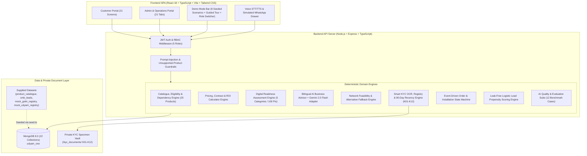
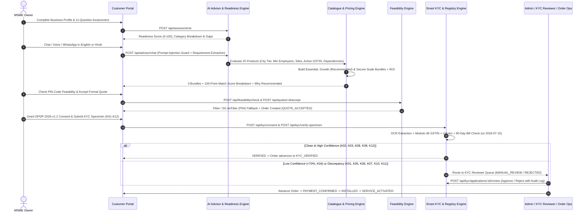

# Udyam One — System Architecture, Database Schema & API Reference
## YTL Hackathon 2026 | Enterprise Track A

---

## 1. Architectural Philosophy

**Udyam One** is engineered around a strict four-layer enterprise architecture designed to prevent LLM hallucinations from corrupting commercial, legal, or network provisioning workflows:

1. **AI Understands the Customer**: Bilingual (English + Hindi) conversational advisor extracts structured business requirements (`employees`, `sites`, `cityTier`, `painPoints`, `budget`) and performs OCR document extraction with confidence scoring.
2. **Deterministic Business Logic Validates the Decision**: Hard-coded catalogue eligibility (`availableCityTiers`, `minEmployees`, `minSites`, `requiresGstin` + Active registry status), companion dependency resolution (`requiresOneOf`), multi-unit pricing (`per_site_month`, `per_seat_month`, `per_camera_month`, `flat_month`), Modulo-36 GSTIN verification, and 90-day address proof recency rules.
3. **Automation Executes the Workflow**: Event-driven Order State Machine (`QUOTE_ACCEPTED` → `KYC_VERIFIED` → `PAYMENT_CONFIRMED` → `PROVISIONING_IN_PROGRESS` → `INSTALLATION_SCHEDULED` → `INSTALLED` → `SERVICE_ACTIVATED`), auto-seeded MongoDB 8.3 persistence, and multi-channel notifications.
4. **Humans Handle Exceptions**: Low-confidence OCR (<70% confidence, e.g., blurred `K04`), registry anomalies (`K01`, `K06`, `K07`, `K10`, `K11`), or explicit customer requests trigger structured human handoffs to Sales Executives or the KYC Reviewer Queue with complete context summaries.

---

## 2. High-Level System Architecture Diagram

---

## 3. End-to-End MSME Onboarding Data Flow

---

## 4. Database Schema (22 MongoDB Collections)

All 22 Mongoose schemas are defined in [`backend/src/models/index.ts`](file:///c:/Users/TANNU/OneDrive/Desktop/airtel/backend/src/models/index.ts):

| # | Collection Name | Model | Key Fields & Indexes | Purpose |
|---|---|---|---|---|
| 1 | `users` | `UserModel` | `userId` (unique), `email` (unique), `role` (`CUSTOMER`, `SALES_EXECUTIVE`, `CHANNEL_PARTNER`, `ADMIN`, `KYC_REVIEWER`), `businessId`, `assignedPartnerId` | Role-based authentication and demo account switching |
| 2 | `businesses` | `BusinessModel` | `businessId` (unique), `legalName`, `tradeName`, `vertical`, `subVertical`, `employeeCount`, `numSites`, `city`, `state`, `pinCode`, `cityTier`, `gstin`, `gstinStatus`, `udyamNumber`, `currentMonthlySpend`, `locations[]`, `isDemoScenario`, `scenarioKey` | MSME business profile and multi-location metadata |
| 3 | `products` | `ProductModel` | `productId` (`P01`–`P25`, unique), `category`, `name`, `listPriceInr`, `priceUnit`, `setupFeeInr`, `contractMonths`, `slaUptimePct`, `minEmployees`, `minSites`, `requiresGstin`, `availableCityTiers[]`, `requiresOneOf[]`, `recommendedVerticals[]` | Exact 25-product enterprise catalogue imported from `product_catalogue.csv` |
| 4 | `leads` | `LeadModel` | `leadId` (unique), `isHistorical` (indexed), `businessId`, `channel`, `city`, `cityTier`, `vertical`, `employeeCount`, `numSites`, `hasGstin`, `hasUdyam`, `currentBroadbandSpendInr`, `stageReached`, `dropReason`, `propensityScore`, `propensityBand`, `humanHandoffRequested` | Stores 5,000 historical leads (`isHistorical: true`) strictly separated from live prototype leads (`isHistorical: false`) |
| 5 | `gstregistrations` | `GstRegistrationModel` | `gstin` (unique), `legalName`, `tradeName`, `state`, `stateCode`, `pan`, `entityType`, `registrationDate`, `status` (`Active`, `Cancelled`, `Suspended`), `hsnSacPrimary`, `filingFrequency`, `lastReturnFiled` | 3,534 GSTIN records imported from `mock_gstin_registry.csv` |
| 6 | `udyamregistrations` | `UdyamRegistrationModel` | `udyamNumber` (unique), `enterpriseName`, `enterpriseType` (`Micro`, `Small`, `Medium`), `majorActivity`, `nic2digit`, `state`, `district`, `dateOfRegistration`, `investmentInrLakhs`, `turnoverInrLakhs` | 2,723 Udyam records imported from `mock_udyam_registry.csv` |
| 7 | `conversations` | `ConversationModel` | `conversationId` (unique), `businessId`, `leadId`, `language` (`en`, `hi`), `channel` (`WEB`, `VOICE`, `WHATSAPP`), `extractedRequirements`, `messages[]`, `escalatedToHuman`, `handoffSummary` | Bilingual AI Business Advisor chat transcripts and structured JSON extraction |
| 8 | `assessments` | `AssessmentModel` | `assessmentId` (unique), `businessId`, `answers`, `overallScore` (0–100), `maturityLevel`, `categoryScores`, `strengths[]`, `weaknesses[]`, `identifiedGaps[]`, `recommendations[]` | Deterministic 5-category Digital Readiness Score and gap analysis |
| 9 | `recommendations` | `RecommendationModel` | `recommendationId` (unique), `businessId`, `extractedNeeds`, `bundles[]` (`ESSENTIAL`, `GROWTH`, `SECURE_SCALE`), `ineligibleProducts[]`, `roiAnalysis` | Persisted 3-tier bundle comparisons, match score breakdowns, and ineligibility explanations |
| 10 | `quotes` | `QuoteModel` | `quoteId` (unique), `businessId`, `bundleTier`, `lineItems[]`, `monthlyRecurringTotal`, `oneTimeSetupTotal`, `gstPct`, `totalFirstInvoice`, `annualContractValue`, `status`, `validUntil` | Itemized formal commercial quotations with 18% GST and contract lock-in |
| 11 | `kycconsents` | `KycConsentModel` | `consentId` (unique), `businessId`, `userId`, `consentVersion` (`DPDP-2026-v1.2`), `purpose`, `retentionDays` (`180`), `granted`, `grantedAt` | Mandatory pre-upload DPDP Act 2023 audit trail |
| 12 | `kycdocuments` | `KycDocumentModel` | `documentId` (unique), `kycApplicationId`, `specimenId`, `docType`, `fileName`, `filePath`, `ocrConfidence` (0–100), `extractedFields`, `tamperSuspected`, `rotationDetectedDeg`, `blurDetected`, `validationStatus`, `issues[]` | Individual KYC document OCR fields, image quality telemetry, and masked sensitive identifiers |
| 13 | `kycapplications` | `KycApplicationModel` | `kycApplicationId` (unique), `businessId`, `consentId`, `specimenKey` (`K01`–`K12`), `overallStatus` (`PENDING`, `VERIFIED`, `REJECTED`, `MANUAL_REVIEW`), `overallConfidence`, `gstVerification`, `udyamVerification`, `addressProofRecencyDays`, `crossDocChecks[]`, `discrepancyNotes[]` | End-to-end KYC verification record and reviewer decision history |
| 14 | `orders` | `OrderModel` | `orderId` (unique), `businessId`, `quoteId`, `kycApplicationId`, `status`, `feasibilityStatus`, `paymentStatus`, `lineItems[]`, `monthlyTotalWithGst`, `oneTimeTotalWithGst`, `slaDeadline` | Authoritative enterprise order record |
| 15 | `orderstatushistories` | `OrderStatusHistoryModel` | `orderId` (indexed), `fromStatus`, `toStatus`, `actorId`, `actorRole`, `note`, `timestamp` | Immutable audit trail of every order state transition |
| 16 | `installations` | `InstallationModel` | `installationId` (unique), `orderId`, `businessId`, `scheduledSlot`, `technicianName`, `technicianPhone`, `routerSerialNumber`, `opticalPowerDbm`, `speedTestMbps`, `checklist`, `customerSignOff`, `status` | Field technician dispatch, optical power telemetry, and customer sign-off |
| 17 | `notifications` | `NotificationModel` | `notificationId` (unique), `businessId`, `recipientRole`, `channel` (`EMAIL`, `SMS`, `WHATSAPP`, `IN_APP`), `eventType`, `title`, `message`, `read` | Multi-channel transactional alerts across onboarding milestones |
| 18 | `partners` | `PartnerModel` | `partnerId` (unique), `name`, `city`, `state`, `tier`, `assignedLeadsCount`, `convertedLeadsCount`, `commissionEarnedInr`, `activeOrdersCount` | Channel partner portal metrics and commission tracking |
| 19 | `supporttickets` | `SupportTicketModel` | `ticketId` (unique), `businessId`, `orderId`, `category`, `priority`, `subject`, `description`, `aiDiagnosis`, `status`, `resolutionNote` | Post-activation AI diagnostics and ticket management |
| 20 | `referrals` | `ReferralModel` | `referralId` (unique), `referrerBusinessId`, `referralCode`, `referredBusinessName`, `referredPhone`, `city`, `status`, `rewardCreditInr` | Post-activation MSME referral program (`₹1,500` bill credit) |
| 21 | `auditlogs` | `AuditLogModel` | `logId` (unique), `actorId`, `actorName`, `actorRole`, `action`, `entityType`, `entityId`, `details`, `ipAddress`, `createdAt` | Tamper-evident security audit log for KYC, role switches, and order overrides |
| 22 | `aievaluations` | `AiEvaluationModel` | `evalId` (unique), `testCaseId` (`EVAL-01`–`EVAL-12`), `category`, `inputSummary`, `expectedOutcome`, `actualOutcome`, `passed`, `score`, `latencyMs` | Automated AI quality benchmark results |

---

## 5. REST API Reference

All endpoints are served under `/api` (implemented in [`backend/src/routes/apiRoutes.ts`](file:///c:/Users/TANNU/OneDrive/Desktop/airtel/backend/src/routes/apiRoutes.ts)):

### Authentication & Role Switching
- `POST /api/auth/login` — Authenticate by email/password or role and receive a signed JWT.
- `POST /api/auth/register` — Create a new MSME Customer account and linked `Business` profile.
- `POST /api/auth/switch-role` — Switch between `CUSTOMER`, `SALES_EXECUTIVE`, `CHANNEL_PARTNER`, `ADMIN`, and `KYC_REVIEWER` with a fresh role-scoped JWT and audit log entry.
- `GET /api/auth/me` — Inspect current user, active business profile, and available demo roles.

### Demo Mode & Scenarios
- `GET /api/demo/scenarios` — List all 8 pre-configured demo scenarios (`SCENARIO_1` through `SCENARIO_8`).
- `POST /api/demo/load-scenario` — Load or reset a specific scenario (`SCENARIO_1`–`SCENARIO_8`) and return its complete hydrated state (`business`, `assessment`, `recommendation`, `quote`, `kycApplication`, `kycDocuments`, `order`, `installation`, `notifications`, `tickets`, `referrals`).
- `POST /api/demo/reset-all` — Re-seed all 8 demo scenarios to their clean initial state.

### Business Profile & Digital Readiness
- `GET /api/businesses/:businessId` — Fetch business profile.
- `PUT /api/businesses/:businessId` — Update business profile, locations, GSTIN, or Udyam number.
- `POST /api/assessments` — Compute deterministic 5-category Digital Readiness Score (`0–100`) and product gap recommendations.
- `GET /api/assessments/:businessId` — Retrieve latest readiness assessment.

### AI Business Advisor & Recommendations
- `POST /api/advisor/chat` — Send English/Hindi message (`WEB`, `VOICE`, or `WHATSAPP`), enforce prompt-injection and unsupported-product guardrails, extract structured requirements, and regenerate 3-tier recommendations.
- `POST /api/advisor/handoff` — Escalate conversation to a human Sales Executive with structured summary and create/update live lead.
- `GET /api/advisor/:businessId` — Fetch conversation history and extracted JSON requirements.
- `GET /api/products` — List all 25 catalogue products (`P01`–`P25`).
- `POST /api/recommendations/generate` — Run deterministic eligibility, dependency resolution, and 3-tier bundle generation (`ESSENTIAL`, `GROWTH`, `SECURE_SCALE`).
- `POST /api/roi/calculate` — Run interactive ROI & Savings calculator with custom parameter sliders.

### Feasibility, Quotes & Smart KYC
- `POST /api/feasibility/check` — Check PIN code and product list for fiber availability or `P04` 5G AirFiber fallback.
- `POST /api/quotes` — Generate formal quotation with itemized recurring/one-time charges and 18% GST.
- `POST /api/quotes/:quoteId/accept` — Accept quotation and transition/create order in `QUOTE_ACCEPTED`.
- `POST /api/registry/verify-gstin` — Validate GSTIN format, Modulo-36 checksum, positional `0`→`O` OCR normalization, and lookup against `mock_gstin_registry.csv` (`3,534` rows).
- `POST /api/registry/verify-udyam` — Validate Udyam format (`UDYAM-XX-00-XXXXXXX`) and lookup against `mock_udyam_registry.csv` (`2,723` rows).
- `POST /api/kyc/consent` — Record explicit `DPDP-2026-v1.2` consent prior to document upload.
- `GET /api/kyc/specimens` — List all 12 specimen KYC packets (`K01`–`K12`) with document metadata.
- `POST /api/kyc/verify-specimen` — Execute OCR extraction, registry cross-checks, and 90-day address proof verification against `2026-07-15` (requires valid `consentId`).
- `POST /api/kyc/upload` — Upload custom KYC files via `multer` after verifying consent.
- `GET /api/kyc/documents/:docId/file` — Authenticated, role-checked private streaming of KYC specimen PNG images (`K01`–`K12`).
- `GET /api/kyc/queue` — List KYC applications for `KYC_REVIEWER` / `ADMIN`.
- `POST /api/kyc/applications/:kycApplicationId/review` — Approve, reject, or request re-upload with mandatory reviewer note and audit log.

### Orders, Installations, Support & Admin Analytics
- `GET /api/orders` & `GET /api/orders/business/:businessId` — Retrieve order state, history, and installation telemetry.
- `POST /api/orders/:orderId/transition` — Execute validated state transition (`QUOTE_ACCEPTED` → ... → `SERVICE_ACTIVATED`).
- `PUT /api/installations/:installationId` — Update technician slot, optical power (`-18.4 dBm`), speed test, and customer sign-off.
- `POST /api/support/tickets` & `GET /api/support/tickets/:businessId` — Create and track post-activation support tickets with AI diagnostics.
- `POST /api/referrals` & `GET /api/referrals/:businessId` — Create and track MSME referrals.
- `GET /api/admin/analytics` — Full historical (`5,000` leads from `smb_leads.csv`) vs. live prototype acquisition analytics, funnel drop-offs, city-tier economics, and channel CAC vs LTV.
- `GET /api/admin/leads` & `POST /api/admin/leads/:leadId/assign` — Filter leads by propensity band (`HIGH`, `MEDIUM`, `LOW`) and assign to sales executives or channel partners (`SALES_EXECUTIVE`, `CHANNEL_PARTNER`, `ADMIN`).
- `GET /api/admin/partners` — Channel partner leaderboard and commission analytics (`CHANNEL_PARTNER`, `ADMIN`).
- `GET /api/admin/audit-logs` — View immutable security audit logs (`ADMIN`, `KYC_REVIEWER`).
- `POST /api/admin/ai-eval/run` & `GET /api/admin/ai-eval` — Execute and inspect the 12-case AI Evaluation Benchmark Suite (`ADMIN`).
